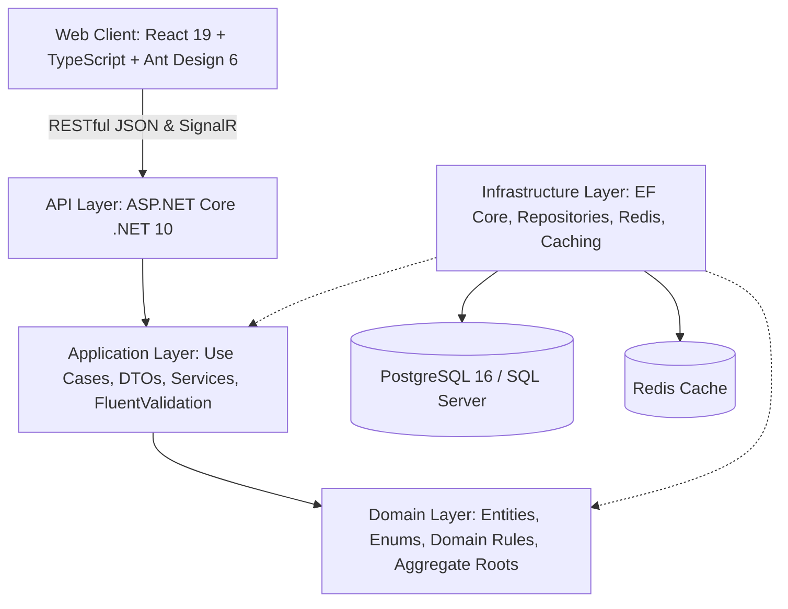

# 🦞 Seafood Warehouse Management System (Seafood WMS)

> **Hệ thống Quản lý Vận hành Kho Vận Thủy Hải Sản Chuyên Nghiệp**  
> Xây dựng trên nền tảng **.NET 10**, **React 19**, **Clean Architecture**, tích hợp **Multi-tenancy**, **FEFO Engine**, **Catch-weight Management** và tối ưu hóa truy vấn **Big Data (P95 < 15ms)**.

---

[](https://github.com/leo112000/SeafoodWarehouse/actions)
[](https://github.com/leo112000/SeafoodWarehouse/actions)


---

## 🌐 Live Demo & Cloud Deployment

Hệ thống đã được triển khai và hoạt động thực tế trên Cloud:
* 🖥️ **Frontend SPA**: [seafood-warehouse.vercel.app](https://seafood-warehouse.vercel.app) *(Triển khai trên **Vercel**)*
* 🔌 **Backend Web API**: Triển khai trên **Render** *(Dockerized .NET 10 Web Service)*
* 🗄️ **Database**: **Supabase** *(Managed PostgreSQL 16 Cloud, SSL, Auto DDL Init)*

---

## 📌 1. Bối cảnh & Bài toán Nghiệp vụ (Domain Problem)

Kho vận thủy hải sản sở hữu các đặc tính bảo quản và vận hành phức tạp mà các hệ thống WMS bách hóa thông thường không đáp ứng được:

* ⏳ **Cơ chế xuất kho FEFO (First-Expired, First-Out)**: Hải sản suy giảm phẩm cấp theo ngày lưu kho. Hệ thống tự động gợi ý và phân bổ các lô hàng có hạn sử dụng gần nhất còn tồn trong kho, hạn chế tối đa rủi ro tồn ứ hàng hỏng.
* ⚖️ **Khối lượng biến đổi (Catch-weight) & Trọng lượng bì (Tare-weight)**: Hải sản nguyên sọt có cân nặng không đồng nhất. Hệ thống tự động nhận diện khối lượng tổng (Gross), trừ trọng lượng sọt nhựa tiêu chuẩn (Tare) để tính chính xác khối lượng tịnh (Net Weight).
* 🔄 **Vòng tuần hoàn Quản lý Bao bì / Vỏ sọt nhựa (Packaging Loan & Return)**: Bài toán thất thoát hàng trăm triệu đồng tiền vỏ sọt đối tác được giải quyết triệt để nhờ module theo dõi mượn - trả và đối soát công nợ vỏ sọt thời gian thực.
* ❄️ **Phân tầng Dải nhiệt độ Kho lạnh & QC Grading**: Kiểm soát nhiệt độ nghiêm ngặt theo phân nhóm: kho đông sâu (-25°C), kho mát (-18°C ~ -10°C), bể thở tươi sống (15°C ~ 18°C) cùng phân hạng phẩm cấp Grade A/B/C và mã kiểm định.

---

## 🏛️ 2. Kiến trúc Hệ thống (Clean Architecture)

Hệ thống tuân thủ nghiêm ngặt **Clean Architecture 4 tầng** kết hợp **Domain-Driven Design (DDD)**:



* **API Layer**: Controller mỏng, xác thực JWT & Refresh Token, tích hợp **Scalar OpenAPI** (chuẩn tài liệu API thế hệ mới của .NET), push thông báo ngầm qua **SignalR**.
* **Application Layer**: Điều phối các nghiệp vụ xuất/nhập/tồn kho, trừ vỏ sọt, phân trang và cache-aside service.
* **Domain Layer**: Nghiệp vụ thuần túy không phụ thuộc framework (`LotBatch`, `InventoryTransaction`, `PackagingLoan`, `Tenant`...).
* **Infrastructure Layer**: EF Core với cơ chế **Hybrid Provider** (SQL Server cho môi trường local/test và PostgreSQL cho môi trường Docker/Supabase) kết hợp **Multi-tenancy Global Query Filter** (`IMustHaveTenant`).

---

## ⚡ 3. Tối ưu Hiệu năng & Benchmark Big Data

Hệ thống được thiết kế và kiểm thử hiệu năng chịu tải trên tập dữ liệu lớn với **50,000+ Lô hàng** và **100,000+ Giao dịch**:

| Hạng mục kiểm thử | Kỹ thuật tối ưu | Trước tối ưu | Sau tối ưu | Cải thiện |
|---|---|:---:|:---:|:---:|
| **Quét lô FEFO (50,000 records)** | Filtered Index `IX_LotBatches_FEFO` | ~210 ms (Table Scan) | **P95 < 14.8 ms** (Index Seek) | **Nhanh gấp ~14 lần** |
| **Phân trang sâu (Deep Paging 100k tx)** | Composite Index `(TenantId, CreatedAt DESC)` | ~380 ms | **< 28.5 ms** | **Nhanh gấp ~13 lần** |
| **Truy vấn Danh mục & Kho bãi** | Redis Distributed Cache (Cache-Aside) | ~45.2 ms (DB Query) | **< 1.8 ms** (RAM Hit) | **Nhanh gấp ~25 lần** |
| **Độ ổn định chịu tải** | 50 Threads Concurrency Test | - | **100% Success (500 reqs)** | Zero Deadlock |

*(Bộ test benchmark được thực thi tự động qua test suite [BigDataPerformanceTests.cs](backend/tests/Tests/BigDataPerformanceTests.cs)).*

---

## 🛠️ 4. Công nghệ Sử dụng (Tech Stack)

### Backend
* **Runtime**: ASP.NET Core (.NET 10)
* **Kiến trúc**: Clean Architecture, Repository & Unit of Work Pattern, Multi-tenancy
* **ORM & Database**: Entity Framework Core, PostgreSQL 16 (Alpine), SQL Server
* **Caching & Real-time**: Redis (`StackExchange.Redis`), MemoryCache Fallback, SignalR
* **Tác vụ ngầm**: .NET `BackgroundService` với Scoped Lifetime Isolation (`IServiceScopeFactory`)
* **API Documentation**: Scalar OpenAPI (`Scalar.AspNetCore`)

### Frontend
* **Core**: React 19, TypeScript 6, Vite 8
* **UI & Styling**: Ant Design 6.6, Tailwind CSS
* **Quản lý State & Data Fetching**: TanStack React Query v5, Zustand v5
* **Tương tác Kho Vận**: Quét mã QR/Barcode qua Camera (`html5-qrcode`), in tem nhãn nhiệt dán sọt (`react-to-print`), xuất/nhập bảng kê Excel (`xlsx`)
* **Code Quality**: Oxlint (Rust-based linter siêu tốc), Vitest

### DevOps & Testing
* **Containerization**: Multi-stage Dockerfile, Docker Compose
* **CI/CD**: GitHub Actions tự động build, lint, typecheck và chạy toàn bộ unit tests
* **Kiểm thử**: xUnit (Backend Unit & Benchmarks), Vitest (Frontend), **Playwright** (7 luồng E2E tự động)

---

## 🚀 5. Hướng dẫn Cài đặt & Khởi chạy Nhanh

### Cách 1: Khởi chạy 1 lệnh với Docker Compose (Khuyên dùng)

Đảm bảo bạn đã cài đặt [Docker Desktop](https://www.docker.com/).

```bash
# 1. Clone repository
git clone https://github.com/leo112000/SeafoodWarehouse.git
cd SeafoodWarehouse

# 2. Khởi chạy toàn bộ hệ thống (PostgreSQL + .NET 10 API + React Frontend)
docker compose up -d --build
```

Sau khi khởi chạy:
* 🌐 **Frontend Application**: `http://localhost:3000`
* 🔌 **Backend Scalar API Docs**: `http://localhost:5000/scalar/v1`
* 🗄️ **PostgreSQL Port**: `localhost:5432`

---

### Cách 2: Khởi chạy Thủ công (Local Development)

#### 1. Backend (.NET 10)
```bash
cd backend/src/API
dotnet restore
dotnet run
# API sẽ lắng nghe tại http://localhost:5000
```

#### 2. Frontend (React 19)
```bash
cd frontend
npm install
npm run dev
# Web app sẽ chạy tại http://localhost:5173
```

---

## 🧪 6. Kiểm thử Toàn diện (Testing & QA)

Dự án có script chạy toàn bộ quy trình kiểm thử 6 bước tích hợp:

```powershell
# Chạy toàn bộ test từ root project
./scripts/test.ps1
```

Script sẽ tự động thực hiện:
1. `dotnet build backend` - Biên dịch sạch mã nguồn Backend
2. `dotnet test backend` - Chạy 11 bộ test xUnit & Big Data Benchmarks
3. `npm run typecheck` - Kiểm tra kiểu tĩnh TypeScript
4. `npm run lint` - Quét chất lượng code với Oxlint (Rust)
5. `npm test` - Chạy 13 bài test Vitest Frontend
6. `npx playwright test` - Chạy 7 kịch bản E2E tự động (Auth, Nhập kho, FEFO Xuất kho, Mượn trả sọt...)

---

## 📁 7. Cấu trúc Thư mục Dự án

```text
SeafoodWarehouse/
├── .github/workflows/          # GitHub Actions CI Pipeline (ci.yml)
├── backend/
│   ├── src/
│   │   ├── API/                # Controllers, Hubs SignalR, BackgroundServices, Scalar
│   │   ├── Application/        # UseCases, Services, DTOs, Business Rules
│   │   ├── Domain/             # Entities (LotBatch, Packaging, Tenant...), Enums
│   │   └── Infrastructure/     # EF Core, Migrations, Repositories, Redis, Providers
│   └── tests/
│       └── Tests/              # xUnit Unit Tests & BigDataPerformanceTests.cs
├── frontend/
│   ├── src/
│   │   ├── components/         # Reusable UI, QR Scanners, Print Templates
│   │   ├── pages/              # Inbound, Outbound FEFO, Packaging Loans, Reports...
│   │   ├── services/           # TanStack Query & Axios API Clients
│   │   └── stores/             # Zustand State Stores
│   └── tests/                  # Vitest Unit Tests
├── e2e/                        # Playwright 7 kịch bản E2E End-to-End
├── docs/                       # Tài liệu đặc tả yêu cầu SRS & Architecture
├── docker-compose.yml          # Docker Compose định nghĩa full-stack services
└── scripts/test.ps1            # Automation script kiểm thử 6 bước toàn diện
```

---

## 📄 8. Bản quyền (License)

Dự án được phân phối dưới giấy phép **MIT License**. Mọi đóng góp và mã nguồn đều tự do sử dụng cho mục đích học tập và phát triển.
