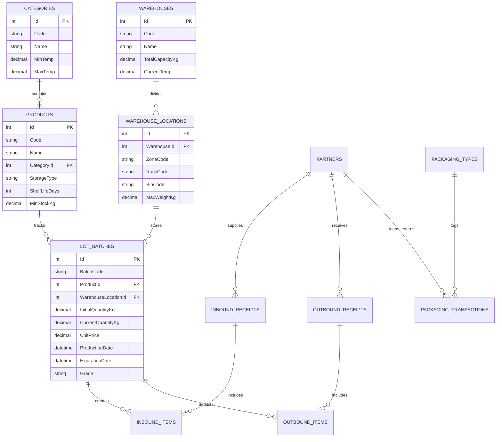

# SOFTWARE REQUIREMENTS SPECIFICATION (SRS)
## HỆ THỐNG QUẢN LÝ KHO THỦY HẢI SẢN (SEAFOOD WAREHOUSE MANAGEMENT SYSTEM - SEAFOOD WMS)

---

**Dự án**: Seafood Warehouse Management System (Seafood WMS)  
**Tác giả**: Senior Business Analyst & Solution Architect  
**Phiên bản**: 3.0.0 (Enterprise Specification)  
**Ngày phát hành**: 23/08/2026  
**Trạng thái**: Đã phê duyệt kỹ thuật & Sẵn sàng triển khai  

---

## MỤC LỤC
1. [GIỚI THIỆU TỔNG QUAN (SCOPE & OBJECTIVES)](#1-giới-thiệu-tổng-quan-scope--objectives)
2. [MÔ TẢ TỔNG QUAN HỆ THỐNG (OVERALL DESCRIPTION)](#2-mô-tả-tổng-quan-hệ-thống-overall-description)
3. [YÊU CẦU CHỨC NĂNG CHI TIẾT (FUNCTIONAL REQUIREMENTS)](#3-yêu-cầu-chức-năng-chi-tiết-functional-requirements)
   - 3.1. [Module 1: Quản lý Danh mục & Sản phẩm Hải sản](#31-module-1-quản-lý-danh-mục--sản-phẩm-hải-sản)
   - 3.2. [Module 2: Quản lý Nhập kho (Inbound Management)](#32-module-2-quản-lý-nhập-kho-inbound-management)
   - 3.3. [Module 3: Quản lý Xuất kho theo Cơ chế FEFO & FIFO](#33-module-3-quản-lý-xuất-kho-theo-cơ-chế-fefo--fifo)
   - 3.4. [Module 4: Quản lý Tồn kho, Vị trí Kệ & Đảo kho (Inventory & Slotting)](#34-module-4-quản-lý-tồn-kho-vị-trí-kệ--đảo-kho-inventory--slotting)
   - 3.5. [Module 5: Báo cáo & Thống kê Phân tích (Analytics & Reports)](#35-module-5-báo-cáo--thống-kê-phân-tích-analytics--reports)
   - 3.6. [Module 6: Quản trị Hệ thống & Phân quyền (RBAC & Audit Logs)](#36-module-6-quản-trị-hệ-thống--phân-quyền-rbac--audit-logs)
4. [YÊU CẦU PHI CHỨC NĂNG (NON-FUNCTIONAL REQUIREMENTS)](#4-yêu-cầu-phi-chức-năng-non-functional-requirements)
5. [THIẾT KẾ DỮ LIỆU & TÍCH HỢP HỆ THỐNG (DATA DESIGN & API SPECIFICATIONS)](#5-thiết-kế-dữ-liệu--tích-hợp-hệ-thống-data-design--api-specifications)

---

## 1. GIỚI THIỆU TỔNG QUAN (SCOPE & OBJECTIVES)

### 1.1. Mục đích
Tài liệu Đặc tả Yêu cầu Phần mềm (SRS) này xác định toàn bộ các yêu cầu chức năng, phi chức năng, luồng nghiệp vụ chuẩn, kiến trúc dữ liệu và giao thức giao tiếp cho **Hệ thống Quản lý Kho Thủy Hải Sản (Seafood WMS)**. Tài liệu là chuẩn mực giao tiếp duy nhất giữa Đội ngũ Nghiệp vụ (BA, Chủ kho), Kiến trúc sư Giải pháp (Solution Architect), Kỹ sư Phát triển (Full-stack Developers) và Đội ngũ Kiểm thử Chất lượng (QA/QC).

### 1.2. Phạm vi Dự án
Hệ thống giải quyết toàn diện bài toán kho vận lạnh chuyên ngành thủy hải sản từ khâu:
- Tiếp nhận hàng từ tàu cá/vùng nuôi trồng.
- Kiểm định nhiệt độ tiếp nhận và phân loại phẩm cấp (Grade A, B, C).
- In mã tem Barcode/QR định danh cho từng sọt/thùng hàng.
- Xếp hàng vào đúng buồng lạnh (Kho cấp đông sâu -25°C, kho mát -18°C ~ -10°C, bể sống oxy 15°C ~ 18°C).
- Xuất kho theo chiến lược FEFO (First-Expired, First-Out).
- Quản lý mượn/trả vỏ sọt nhựa đối tác và kiểm soát tỷ lệ hao hụt tự nhiên/rã đông.

### 1.3. Định nghĩa Thuật ngữ Đặc thù (Glossary)
| Thuật ngữ | Tiếng Anh | Định nghĩa & Ý nghĩa nghiệp vụ |
| :--- | :--- | :--- |
| **Lô hàng** | Batch / Lot | Tập hợp hải sản cùng loại, cùng thời điểm thu mua, cùng nhà cung cấp/tàu cá và có cùng hạn bảo quản. |
| **Chiến lược FEFO** | First-Expired, First-Out | Nguyên tắc xuất kho ưu tiên lô hàng có hạn sử dụng gần nhất xuất trước nhằm hạn chế tối đa rủi ro suy giảm chất lượng hoặc quá hạn. |
| **Chiến lược FIFO** | First-In, First-Out | Nguyên tắc xuất hàng hóa nhập trước xuất trước (áp dụng cho nhóm hàng khô hoặc phụ gia đóng gói). |
| **Khối lượng biến đổi** | Catch-weight | Đặc thù của hải sản nguyên con/nguyên sọt: cùng 1 thùng nhưng khối lượng thực tế từng thùng khác nhau (ví dụ: Thùng 1 = 20.4kg, Thùng 2 = 21.1kg). |
| **Hao hụt trọng lượng** | Shrinkage / Loss | Khối lượng hao hụt tự nhiên do mất nước trong quá trình trữ đông sâu hoặc rã đông sơ bộ. |
| **Trọng lượng bì** | Tare Weight | Khối lượng của vỏ sọt nhựa, khay đựng hoặc đá ướp bảo quản cần trừ đi khi cân để lấy khối lượng tịnh (Net Weight). |
| **Dãy kệ & Ô chứa** | Rack & Bin/Slot | Tọa độ lưu kho cụ thể trong kho lạnh (ví dụ: Kệ A1, Ô A1-02). |

---

## 2. MÔ TẢ TỔNG QUAN HỆ THỐNG (OVERALL DESCRIPTION)

### 2.1. Kiến trúc Hệ thống (System Architecture)
Hệ thống được thiết kế theo mô hình **Clean Architecture / Domain-Driven Design (DDD)** kết hợp cơ chế Single Page Application (SPA):
- **Frontend Layer**: React 18, TypeScript, Vite, Tailwind CSS, Ant Design 5.x, Web Audio API, Html5-Qrcode.
- **API Gateway / Web API Layer**: ASP.NET Core 8 Web API, Controllers mỏng, RESTful JSON tiêu chuẩn, Swagger/OpenAPI.
- **Application Layer**: Use Cases, Command/Query Handlers, AutoMapper DTOs, FluentValidation, Authorization Handlers.
- **Domain Layer**: Core Entities, Enums, Aggregate Roots, Domain Services, Domain Events.
- **Infrastructure Layer**: Entity Framework Core 8, Repository Pattern, SQL Server, Redis Caching, Web Serial API (Giao tiếp cân điện tử & máy in tem nhiệt).

### 2.2. Các Nhóm Tác nhân (Actors)
1. **Thủ kho (Warehouse Keeper)**: Tạo phiếu nhập, kiểm tra vị trí trống trên sơ đồ kho 2D, thực hiện xuất kho, quét mã Barcode/QR bằng máy PDA cầm tay.
2. **Nhân viên Kiểm hàng / Phân loại (QC / Grader)**: Cân trọng lượng thực tế, đo nhiệt độ lúc nhập, phân loại phẩm cấp hải sản (Grade A/B/C), ghi nhận tỷ lệ hao hụt.
3. **Quản lý Kho (Warehouse Manager)**: Phê duyệt phiếu xuất kho số lượng lớn, duyệt biên bản hủy/hạ cấp hải sản (Wastage), cấu hình dải nhiệt độ buồng lạnh và ngưỡng cảnh báo cận date.
4. **Kế toán Kho (Warehouse Accountant)**: Đối soát khối lượng, đơn giá nhập/xuất, theo dõi công nợ vỏ sọt nhựa và xuất báo cáo Xuất - Nhập - Tồn theo kỳ kế toán.
5. **Quản trị viên Hệ thống (System Admin)**: Quản lý tài khoản người dùng, phân quyền vai trò (RBAC), quản lý cấu hình chi nhánh (Multi-tenancy) và giám sát Audit Logs.

### 2.3. Ràng buộc Kỹ thuật & Tiêu chuẩn An toàn Kho Lạnh
- **Dải nhiệt độ nghiêm ngặt**:
  - Kho cấp đông sâu: Nhiệt độ duy trì từ -25°C đến -18°C (Cá, mực, bạch tuộc).
  - Kho mát/đông vừa: Nhiệt độ duy trì từ -18°C đến -10°C (Tôm, cua trữ lạnh).
  - Bể thở hải sản tươi sống: Nhiệt độ nước biển từ 15°C đến 18°C có sục khí oxy liên tục.
- **Thao tác trong điều kiện găng tay bảo hộ**: Giao diện Web/PDA phải hỗ trợ phím bấm lớn, độ tương phản cao (chống lóa trong kho tối/ánh đèn vàng), có âm thanh phản hồi khi quét mã thành công.

---

## 3. YÊU CẦU CHỨC NĂNG CHI TIẾT (FUNCTIONAL REQUIREMENTS)

### 3.1. Module 1: Quản lý Danh mục & Sản phẩm Hải sản

#### [UC-01] Quản lý Danh mục Nhóm Hải sản (Product Categories)
- **Tác nhân**: Quản lý kho, Thủ kho.
- **Tiền điều kiện**: Người dùng đã đăng nhập và có quyền `Pages.Categories.View` / `Pages.Categories.Manage`.
- **Luồng xử lý chính**:
  1. Người dùng truy cập màn hình Danh mục nhóm.
  2. Hệ thống hiển thị danh sách nhóm: *Cá đông lạnh, Tôm/Tép, Cua/Ghẹ, Thân mềm (Mực/Bạch tuộc), Hải sản sống, Hàng khô*.
  3. Người dùng tạo mới/chỉnh sửa thông tin: Mã nhóm, Tên nhóm, Dải nhiệt độ bảo quản yêu cầu (°C), Ghi chú.
  4. Hệ thống kiểm tra tính duy nhất của Mã nhóm và lưu vào CSDL.
- **Hậu điều kiện**: Nhóm danh mục mới có hiệu lực để gắn cho các sản phẩm hải sản.

#### [UC-02] Quản lý Sản phẩm Hải sản & Quy chuẩn Bảo quản (Products)
- **Tác nhân**: Quản lý kho, Thủ kho.
- **Tiền điều kiện**: Có quyền `Pages.Products.Manage`.
- **Luồng xử lý chính**:
  1. Người dùng chọn "Thêm mới Sản phẩm hải sản".
  2. Nhập các trường thông tin:
     - `Code`: Mã sản phẩm (Unique, VD: `FISH-001`, `SHRIMP-002`).
     - `Name`: Tên thương phẩm (VD: *Cá hồi Na Uy phi lê, Tôm sú sống Size 20 con/kg*).
     - `CategoryId`: Nhóm danh mục tương ứng.
     - `StorageType`: Loại bảo quản (`FROZEN` - Cấp đông, `FRESH` - Tươi ướp đá, `ALIVE` - Bể sống, `DRY` - Đồ khô).
     - `TargetTemperature`: Nhiệt độ bảo quản chuẩn (°C).
     - `ShelfLifeDays`: Số ngày bảo quản tối đa (Shelf Life).
     - `MinStockKg`: Định mức tồn kho tối thiểu cảnh báo.
     - `DefaultUnit`: Đơn vị tính (`kg`, `thùng`, `con`).
  3. Hệ thống validate và lưu dữ liệu.
- **Hậu điều kiện**: Sản phẩm sẵn sàng cho các nghiệp vụ Nhập/Xuất kho.

---

### 3.2. Module 2: Quản lý Nhập kho (Inbound Management)

#### [UC-03] Tiếp nhận Hàng & Lập Phiếu Nhập Kho (Inbound Receipt Creation)
- **Tác nhân**: Thủ kho, Nhân viên kiểm hàng.
- **Tiền điều kiện**: Có quyền `Pages.Inbound.Create`.
- **Luồng xử lý chính**:
  1. Thủ kho chọn Tàu cá / Nhà cung cấp và Kho lạnh tiếp nhận.
  2. Thêm các dòng chi tiết mặt hàng nhập:
     - Chọn sản phẩm hải sản.
     - Nhập khối lượng tổng (Gross Weight), trừ khối lượng bì/vỏ sọt (Tare Weight) để ra khối lượng tịnh (Net Weight Kg).
     - Nhập đơn giá thu mua (VNĐ/kg).
     - Chọn Ngày đánh bắt / Ngày cấp đông (`ProductionDate`) và Hạn sử dụng (`ExpirationDate`).
     - Đo và ghi nhận nhiệt độ thực tế lúc tiếp nhận (°C) (VD: -20.5°C).
     - Chọn phẩm cấp cảm quan: `Grade A`, `Grade B`, `Grade C`.
     - Ghi nhận số lượng vỏ sọt nhựa nhận kèm từ tàu cá.
  3. Hệ thống tự động sinh Mã lô hàng duy nhất theo định dạng `LOT-YYYYMMDD-XXXX`.
  4. Thủ kho chọn vị trí ô lưu trữ trên Sơ đồ kho (VD: Ô `A1-01`).
  5. Bấm "Lưu & In Mã Tem": Hệ thống lưu phiếu, phát âm thanh Beep xác nhận và gửi lệnh in mã QR/Barcode tới máy in nhiệt.
- **Luồng phụ (Nhiệt độ không đạt chuẩn)**:
  - Nếu nhiệt độ lúc nhập vượt quá ngưỡng cho phép (VD: Cá đông nhưng nhiệt độ chỉ đạt -5°C), hệ thống bật cảnh báo màu cam và yêu cầu nhập lý do vào trường Ghi chú.
- **Hậu điều kiện**: Tồn kho tăng thời gian thực; Sơ đồ kho 2D cập nhật tỷ lệ lấp đầy của ô kệ tương ứng.

---

### 3.3. Module 3: Quản lý Xuất kho theo Cơ chế FEFO & FIFO

#### [UC-04] Xuất Kho Hải sản Tối ưu theo Chiến lược FEFO (Outbound Picking)
- **Tác nhân**: Thủ kho.
- **Tiền điều kiện**: Có quyền `Pages.Outbound.Create`.
- **Luồng xử lý chính**:
  1. Thủ kho tạo phiếu xuất mới, chọn Khách hàng / Đại lý thu mua và Kho xuất.
  2. Chọn mặt hàng cần xuất và số lượng yêu cầu (Kg).
  3. **Thuật toán Gợi ý FEFO Tự động**:
     - Hệ thống tự động quét toàn bộ các lô hàng của sản phẩm đó trong kho.
     - Sắp xếp theo thứ tự ưu tiên: Lô có `ExpirationDate` gần nhất lên đầu.
     - Hiển thị vị trí ô kệ chính xác đang chứa lô đó (VD: *Lô LOT-20260810-001 tại Kệ A1-02 còn hạn 12 ngày*).
  4. Thủ kho dùng máy quét PDA quét mã Barcode/QR trên thùng hàng thực tế:
     - **Quét đúng lô FEFO gợi ý**: Hệ thống phát tiếng Beep trong trẻo và tick xanh xác nhận.
     - **Quét sai lô (hoặc quét lô có hạn dài hơn trong khi còn lô cận hạn)**: Hệ thống phát tiếng Buzzer trầm và hiển thị thông báo: *"Cảnh báo: Có lô hàng khác cận hạn hơn chưa được xuất trước. Bạn có muốn tiếp tục?"*.
  5. Nhập số lượng xuất thực tế và ghi nhận số lượng sọt nhựa cho khách mượn mang đi hoặc khách trả lại.
  6. Bấm "Hoàn tất Xuất Kho": Hệ thống trừ số lượng tồn kho theo đúng mã lô và in Phiếu Xuất Kho chuẩn khổ A4.
- **Hậu điều kiện**: Tồn kho của lô hàng giảm tương ứng; công nợ vỏ sọt của khách hàng được cập nhật.

---

### 3.4. Module 4: Quản lý Tồn kho, Vị trí Kệ & Đảo kho (Inventory & Slotting)

#### [UC-05] Sơ đồ Trực quan 2D & Điều chuyển Ô Kệ (Visual Map & Bin Relocation)
- **Tác nhân**: Thủ kho, Quản lý kho.
- **Tiền điều kiện**: Có quyền `Pages.Inbound.View`.
- **Luồng xử lý chính**:
  1. Mở màn hình "Sơ đồ Kho Lạnh 2D" (`/inventory/map`).
  2. Xem toàn cảnh các phân khu (Zone A, Zone B, Zone C) và các dãy kệ (Racks).
  3. Từng ô chứa (Bin) được phân biệt bằng màu trực quan:
     - Xanh lá: Tỷ lệ lấp đầy dưới 50%.
     - Vàng: Lấp đầy từ 50% đến 85%.
     - Đỏ: Đầy tải trên 85%.
     - Tím nhấp nháy: Chứa lô hàng Cận Date (<= 15 ngày).
  4. Click vào một ô bất kỳ để mở Drawer danh sách các lô hàng đang lưu trữ tại ô đó.
  5. Chọn tác vụ "Đảo kho / Chuyển vị trí": Chọn lô hàng $\rightarrow$ Chọn ô đích mới $\rightarrow$ Xác nhận di chuyển.
- **Hậu điều kiện**: Tọa độ lưu kho của lô hàng được cập nhật tức thì.

#### [UC-06] Xử lý Hao hụt Khối lượng & Hạ cấp Phẩm chất (Wastage & Downgrade)
- **Tác nhân**: Nhân viên kiểm hàng, Quản lý kho.
- **Tiền điều kiện**: Có quyền `Pages.Wastage.Create`.
- **Luồng xử lý chính**:
  1. Người dùng chọn lô hàng phát sinh hao hụt.
  2. Chọn lý do: *Mất nước tự nhiên (Shrinkage), Hư hỏng rã đông (Spoilage), Chết ngạt trong bể oxy, Hạ cấp chất lượng (Grade A -> Grade B)*.
  3. Nhập khối lượng hao hụt (Kg) và biện pháp xử lý (*Tiêu hủy, Bán tháo thanh lý, Tái chế làm bột cá*).
  4. Nếu giá trị hao hụt vượt quá hạn mức quy định (> 5.000.000 VNĐ), phiếu chuyển sang trạng thái "Chờ Quản lý phê duyệt".
  5. Khi được duyệt, hệ thống tự động trừ tồn kho và ghi nhận chi phí hao hụt.
- **Hậu điều kiện**: Số lượng tồn kho được điều chỉnh chính xác; báo cáo hao hụt ghi nhận số liệu.

---

### 3.5. Module 5: Báo cáo & Thống kê Phân tích (Analytics & Reports)

#### [UC-07] Báo cáo Nhập - Xuất - Tồn & Hao hụt Định kỳ
- **Tác nhân**: Kế toán kho, Quản lý kho, Admin.
- **Tiền điều kiện**: Có quyền `Pages.Reports.View`.
- **Luồng xử lý chính**:
  1. Chọn khoảng thời gian báo cáo (Hôm nay, Tuần này, Tháng này, Tùy chọn từ ngày... đến ngày...).
  2. Lọc theo Kho lạnh, Nhóm mặt hàng hoặc Nhà cung cấp.
  3. Hệ thống kết xuất:
     - Biểu đồ Sản lượng Nhập - Xuất theo thời gian thực (BarChart).
     - Biểu đồ Cơ cấu Tồn kho theo từng loại hải sản (PieChart).
     - Bảng tổng hợp chi tiết: Tồn đầu kỳ, Nhập trong kỳ, Xuất trong kỳ, Hao hụt trong kỳ, Tồn cuối kỳ, Ước tính thành tiền (VNĐ).
  4. Người dùng bấm "Xuất Excel (.xlsx)": Hệ thống tải xuống tệp bảng tính có đầy đủ định dạng số và tiêu đề chuẩn kế toán.

---

### 3.6. Module 6: Quản trị Hệ thống & Phân quyền (RBAC & Audit Logs)

#### [UC-08] Phân quyền Theo Vai trò (Role-Based Access Control)
- **Tác nhân**: System Admin.
- **Tiền điều kiện**: Có quyền `Pages.Roles.Manage`.
- **Nội dung**:
  - Quản lý danh sách vai trò: `Admin`, `WarehouseManager`, `WarehouseKeeper`, `Accountant`, `Inspector`.
  - Phân quyền theo ma trận chi tiết: Phân quyền xem, tạo mới, chỉnh sửa, xóa và phê duyệt trên từng chức năng.

#### [UC-09] Nhật ký Hoạt động Hệ thống (Audit Logging)
- **Tác nhân**: System Admin, Quản lý kho.
- **Nội dung**:
  - Ghi nhận tự động mọi tác vụ thay đổi dữ liệu trọng yếu (Sửa giá nhập, điều chỉnh khối lượng tồn, xóa phiếu xuất, đổi vị trí ô kệ).
  - Lưu vết: `UserId`, `UserName`, `ClientIpAddress`, `ActionName`, `ExecutionTime`, `OldValues (JSON)`, `NewValues (JSON)`.

---

## 4. YÊU CẦU PHI CHỨC NĂNG (NON-FUNCTIONAL REQUIREMENTS)

### 4.1. Hiệu năng & Tốc độ Phản hồi (Performance & Latency)
- **Độ trễ API**: Thời gian phản hồi cho 95% các API truy vấn danh sách, tồn kho phải dưới 200ms.
- **Tốc độ Quét mã**: Thời gian từ lúc camera nhận diện Barcode/QR đến khi phát âm thanh phản hồi và render kết quả phải dưới 100ms.
- **Tải đồng thời**: Hệ thống hỗ trợ tối thiểu 200 người dùng thao tác cùng lúc và 50 thiết bị PDA quét liên tục mà không gây nghẽn giao dịch CSDL.

### 4.2. Bảo mật & Xác thực (Security & Authentication)
- Xác thực bằng chuẩn **JSON Web Token (JWT)** với Access Token (hạn 60 phút) và Refresh Token (lưu an toàn trong HttpOnly Cookie).
- Mật khẩu người dùng được băm bằng thuật toán **PBKDF2 / Argon2** có muối (Salt).
- Phân tách dữ liệu đa chi nhánh (Multi-tenancy isolation) triệt để ở cấp CSDL thông qua EF Core Global Query Filters.

### 4.3. Tính Toàn vẹn Dữ liệu & Xử lý Đồng thời (Data Integrity & Concurrency)
- **Pessimistic / Optimistic Locking**: Khi 2 thủ kho cùng quét xuất 1 lô hàng cùng một thời điểm, hệ thống sử dụng trường `ConcurrencyStamp` / RowVersion để đảm bảo không bao giờ xảy ra tình trạng xuất âm kho hoặc trùng lặp số lượng.
- **Database Transaction (ACID)**: Các thao tác Nhập/Xuất kho liên quan đến nhiều bảng (Phiếu xuất, Chi tiết phiếu, Tồn kho, Lịch sử giao dịch, Công nợ bao bì) phải được bọc trong một Database Transaction duy nhất. Nếu bất kỳ bước nào lỗi, toàn bộ thao tác tự động Rollback.

---

## 5. THIẾT KẾ DỮ LIỆU & TÍCH HỢP HỆ THỐNG (DATA DESIGN & API SPECIFICATIONS)

### 5.1. Danh sách Thực thể Cốt lõi (Core Entities Schema)

### 5.2. Danh sách RESTful API Endpoints Cốt lõi

| Phương thức | Đường dẫn Endpoint | Mô tả chức năng | Quyền yêu cầu (Permission) |
| :--- | :--- | :--- | :--- |
| **POST** | `/api/auth/login` | Đăng nhập tài khoản & Nhận JWT Access Token | Public |
| **GET** | `/api/inventory/stock` | Truy vấn danh sách hàng tồn kho theo lô & bộ lọc | `Pages.Inbound.View` |
| **GET** | `/api/inventory/visual-map` | Lấy dữ liệu sơ đồ kho 2D, phân khu & tỷ lệ lấp đầy | `Pages.Inbound.View` |
| **POST** | `/api/inbound/receipts` | Tạo phiếu nhập kho hải sản mới & Cấp mã LOT | `Pages.Inbound.Create` |
| **POST** | `/api/outbound/receipts` | Tạo phiếu xuất kho & Gợi ý xuất theo FEFO | `Pages.Outbound.Create` |
| **GET** | `/api/outbound/fefo-suggestions`| Lấy danh sách lô cận date tối ưu cho sản phẩm | `Pages.Outbound.Create` |
| **POST** | `/api/inventory/wastage` | Ghi nhận biên bản hao hụt / hạ cấp phẩm chất | `Pages.Wastage.Create` |
| **POST** | `/api/inventory/relocate` | Điều chuyển lô hàng sang ô kệ / buồng lạnh mới | `Pages.Inbound.Create` |
| **GET** | `/api/reports/summary` | Lấy dữ liệu thống kê tổng hợp Dashboard | `Pages.Reports.View` |
| **GET** | `/api/reports/export-excel` | Xuất báo cáo Xuất - Nhập - Tồn ra tệp Excel (.xlsx) | `Pages.Reports.View` |
| **GET** | `/api/packaging/loan-balance` | Tra cứu số dư công nợ vỏ sọt của đối tác | `Pages.Packaging.View` |

---
*Tài liệu Đặc tả Yêu cầu Phần mềm này là tài sản kỹ thuật chuẩn của dự án Seafood Warehouse Management System. Mọi thay đổi về Use Case hoặc Kiến trúc CSDL cần được thông qua quy trình xét duyệt Change Request (CR) của Solution Architect.*
