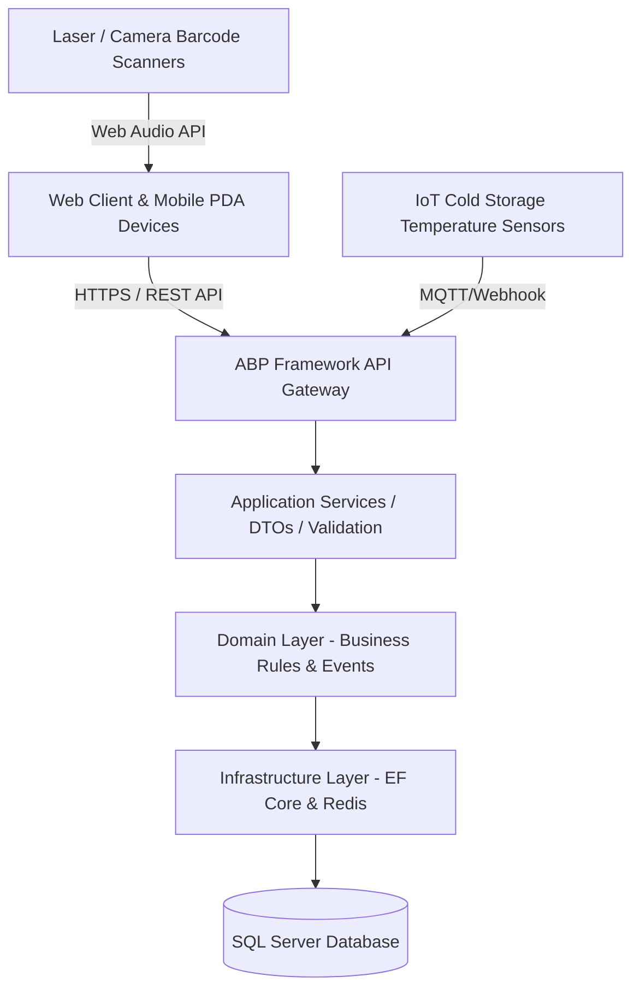
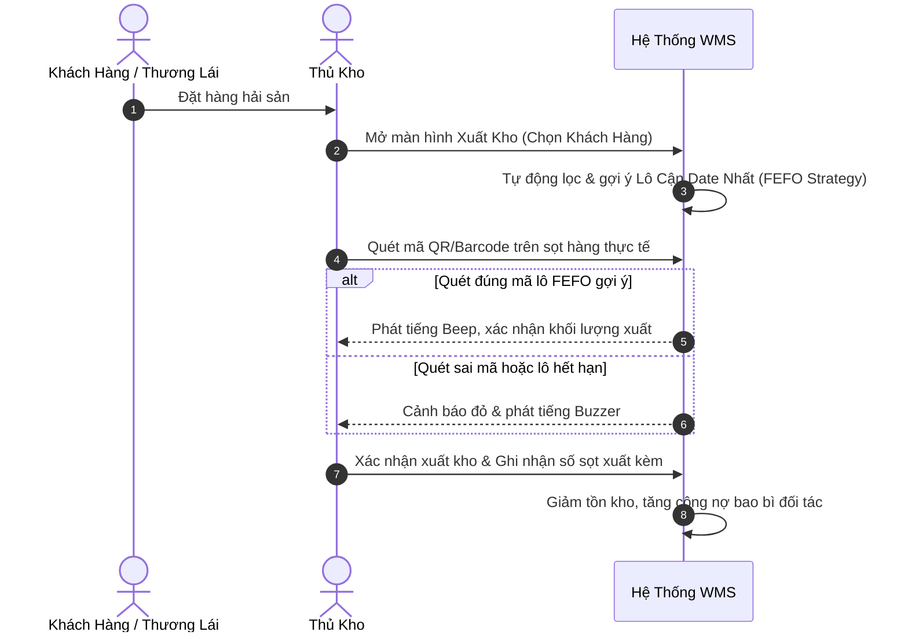

# TÀI LIỆU ĐẶC TẢ YÊU CẦU PHẦN MỀM (SRS)
## HỆ THỐNG QUẢN LÝ KHO THỦY HẢI SẢN (SEAFOOD WAREHOUSE MANAGEMENT SYSTEM - SWMS)

---

**Tên dự án**: Seafood Warehouse Management System (SWMS)  
**Phiên bản**: 2.0.0  
**Ngày lập**: 23/08/2026  
**Trạng thái**: Đã phê duyệt & Đang vận hành  

---

## MỤC LỤC
1. [GIỚI THIỆU TỔNG QUAN](#1-giới-thiệu-tổng-quan)
2. [KIẾN TRÚC VÀ CÔNG NGHỆ HỆ THỐNG](#2-kiến-trúc-và-công-nghệ-hệ-thống)
3. [SƠ ĐỒ LUỒNG NGHIỆP VỤ HỆ THỐNG (SYSTEM WORKFLOWS)](#3-sơ-đồ-luồng-nghiệp-vụ-hệ-thống)
4. [ĐẶC TẢ CHI TIẾT TỪNG PHÂN HỆ VÀ TRƯỜNG NHẬP LIỆU](#4-đặc-tả-chi-tiết-từng-phân-hệ-và-trường-nhập-liệu)
   - 4.1. [Phân hệ Quản lý Nhập kho Hải sản (Inbound Management)](#41-phân-hệ-quản-lý-nhập-kho-hải-sản-inbound-management)
   - 4.2. [Phân hệ Quản lý Xuất kho Hải sản (Outbound Management)](#42-phân-hệ-quản-lý-xuất-kho-hải-sản-outbound-management)
   - 4.3. [Phân hệ Sơ đồ Kho Lạnh 2D & Quản lý Tồn kho (Visual Warehouse Map & Stock)](#43-phân-hệ-sơ-đồ-kho-lạnh-2d--quản-lý-tồn-kho)
   - 4.4. [Phân hệ Quản lý Hao hụt & Phân loại Phẩm cấp (Wastage & Grading)](#44-phân-hệ-quản-lý-hao-hụt--phân-loại-phẩm-cấp)
   - 4.5. [Phân hệ Quản lý Mượn/Trả Vỏ Sọt & Bao Bì (Packaging Management)](#45-phân-hệ-quản-lý-mượntrả-vỏ-sọt--bao-bì)
   - 4.6. [Phân hệ Máy quét Cầm tay Chuyên dụng (PDA Scanner Handheld Mode)](#46-phân-hệ-máy-quét-cầm-tay-chuyên-dụng-pda-scanner)
   - 4.7. [Phân hệ Dữ liệu nền (Master Data Management)](#47-phân-hệ-dữ-liệu-nền-master-data)
   - 4.8. [Phân hệ Báo cáo, Cảnh báo & Giám sát Nhiệt độ](#48-phân-hệ-báo-cáo-cảnh-báo--giám-sát-nhiệt-độ)
   - 4.9. [Phân hệ Quản trị Hệ thống, Phân quyền & Audit Logs](#49-phân-hệ-quản-trị-hệ-thống-phân-quyền--audit-logs)
5. [YÊU CẦU PHI CHỨC NĂNG (NON-FUNCTIONAL REQUIREMENTS)](#5-yêu-cầu-phi-chức-năng)
6. [YÊU CẦU GIAO DIỆN & TRẢI NGHIỆM NGƯỜI DÙNG (UI/UX)](#6-yêu-cầu-giao-diện--trải-nghiệm-người-dùng)

---

## 1. GIỚI THIỆU TỔNG QUAN

### 1.1. Mục đích
Tài liệu Đặc tả Yêu cầu Phần mềm (SRS) này mô tả chi tiết toàn bộ các yêu cầu nghiệp vụ, luồng xử lý, giao diện, quy tắc xác thực từng trường nhập liệu và kiến trúc kỹ thuật của **Hệ thống Quản lý Kho Thủy Hải Sản (SWMS)**. 

### 1.2. Bối cảnh & Phạm vi Nghiệp vụ
Ngành thủy hải sản có những đặc thù cốt lõi so với kho hàng thông thường:
- **Bảo quản nhiệt độ âm sâu**: Yêu cầu kiểm soát chặt chẽ nhiệt độ theo từng phân khu (Kho đông sâu -25°C, kho mát -18°C ~ -10°C, bể sống oxy 15°C ~ 18°C).
- **Hạn sử dụng ngắn & Chiến lược FEFO**: Hàng hóa suy giảm chất lượng theo thời gian; yêu cầu xuất kho ưu tiên lô sắp hết hạn (First-Expired, First-Out).
- **Quy cách đóng gói & Vỏ sọt nhựa**: Quản lý song song luồng hàng hải sản và luồng mượn/trả/thu hồi vỏ sọt, khay nhựa đối với tàu cá và thương lái.
- **Hao hụt tự nhiên & Rã đông**: Theo dõi tỷ lệ mất nước, tỷ lệ phân loại lại phẩm cấp (Grade A -> Grade B/Hao hụt).

---

## 2. KIẾN TRÚC VÀ CÔNG NGHỆ HỆ THỐNG

### 2.1. Ngăn xếp Công nghệ (Technology Stack)
- **Backend**: ASP.NET Core 8 / ABP Framework (Domain-Driven Design), Entity Framework Core.
- **Database**: Microsoft SQL Server / Azure SQL, Redis Cache hỗ trợ truy vấn siêu tốc.
- **Frontend**: React 18, TypeScript, Ant Design 5.x (Modern Ocean Theme), TailwindCSS, Recharts.
- **Tích hợp phần cứng/Thiết bị ngoại vi**:
  - Web Audio API (phản hồi âm thanh Beep/Buzz khi quét mã barcode).
  - Html5-Qrcode camera & thiết bị đầu đọc Barcode/QR Laser 1D/2D.
  - Cổng kết nối máy in nhiệt nhãn phụ và cân điện tử qua Web Serial.

---

## 3. SƠ ĐỒ LUỒNG NGHIỆP VỤ HỆ THỐNG

### 3.1. Luồng Nhập kho Hải sản (Inbound Flow)

```mermaid
sequenceDiagram
    autonumber
    actor Supplier as Tàu Cá / Nhà Cung Cấp
    actor Staff as Nhân Viên Kho
    participant WMS as Hệ Thống WMS
    participant Label as Máy In Mã Vạch

    Supplier->>Staff: Giao hải sản (Thùng / Sọt)
    Staff->>WMS: Tạo Phiếu Nhập Kho (Chọn NCC, Loại Hải Sản, Cân Khối Lượng)
    WMS->>WMS: Kiểm tra hạn mức, tính số lượng sọt bao bì mượn
    WMS->>Label: Sinh mã lô (LOT Batch Code) & In mã QR/Barcode
    Staff->>WMS: Gán vị trí Kệ/Ô lưu trữ (Ví dụ: A1-01)
    WMS->>WMS: Cập nhật Tồn kho thời gian thực & Ghi Audit Log
    WMS-->>Staff: Báo thành công (Beep Audio Feedback)
```

### 3.2. Luồng Xuất kho Hải sản (Outbound FEFO Flow)

---

## 4. ĐẶC TẢ CHI TIẾT TỪNG PHÂN HỆ VÀ TRƯỜNG NHẬP LIỆU

### 4.1. Phân hệ Quản lý Nhập kho Hải sản (Inbound Management)

#### Mục tiêu:
Ghi nhận hàng hóa nhập từ tàu cá hoặc đối tác thu mua, cân trọng lượng, kiểm định chất lượng ban đầu, cấp mã lô và gán vị trí ô lưu trữ kho lạnh.

#### Danh sách Trường Nhập Liệu (Fields Specification):
| Tên Trường | Kiểu Dữ Liệu | Bắt Buộc | Ràng Buộc / Quy Tắc Xác Thực | Mô Tả Nghiệp Vụ |
| :--- | :--- | :---: | :--- | :--- |
| `WarehouseId` | Dropdown (Int) | **Có** | Phải tồn tại trong bảng Warehouses | Kho lạnh tiếp nhận lưu trữ hàng. |
| `PartnerId` | Dropdown (Int) | **Có** | Thuộc loại đối tác SUPPLIER / Tàu cá | Tàu cá hoặc nhà cung ứng hải sản. |
| `ProductId` | Dropdown (Int) | **Có** | Trạng thái Active | Mặt hàng hải sản (Cá hồi, Tôm sú, Cua...). |
| `BatchCode` | Textbox (String) | **Có** | Tự động sinh `LOT-YYYYMMDD-XXXX` hoặc quét QR | Mã định danh duy nhất của lô hàng. |
| `QuantityKg` | Number (Decimal) | **Có** | Lớn hơn 0, tối đa 2 chữ số thập phân | Tổng khối lượng tịnh nhập kho (Kg). |
| `Unit` | Textbox (String) | Không | Mặc định 'kg' | Đơn vị tính khối lượng. |
| `UnitPrice` | Number (Decimal) | **Có** | Lớn hơn hoặc bằng 0 | Đơn giá nhập/kg (VNĐ). |
| `TotalAmount` | Number (Decimal) | Auto | `= QuantityKg * UnitPrice` | Tổng giá trị lô hàng nhập. |
| `ProductionDate` | Datepicker | **Có** | Nhỏ hơn hoặc bằng Ngày hiện tại | Ngày đánh bắt hoặc ngày cấp đông. |
| `ExpirationDate` | Datepicker | **Có** | Lớn hơn ProductionDate | Hạn sử dụng của lô hải sản. |
| `StorageBin` | Textbox/Select | **Có** | Khớp ô trên Sơ đồ kho (VD: A1-01, B2-03) | Vị trí ô kệ xếp hàng vào kho. |
| `Grade` | Select | **Có** | Giá trị: `Grade A`, `Grade B`, `Grade C` | Phẩm cấp chất lượng khi kiểm tra cảm quan. |
| `PackagingTypeId`| Dropdown | Không | Danh mục bao bì | Loại sọt/khay nhựa sử dụng khi nhập. |
| `PackagingQuantity`| Number (Int) | Không | Lớn hơn hoặc bằng 0 | Số lượng sọt giao kèm cần theo dõi trả lại. |
| `Note` | Textarea | Không | Tối đa 500 ký tự | Ghi chú tình trạng tàu, đá bảo quản, độ tươi. |

---

### 4.2. Phân hệ Quản lý Xuất kho Hải sản (Outbound Management)

#### Mục tiêu:
Thực hiện xuất bán cho nhà phân phối, nhà hàng, siêu thị; áp dụng chiến lược xuất lô cận date (FEFO) và thu tiền hoặc theo dõi công nợ vỏ sọt.

#### Danh sách Trường Nhập Liệu (Fields Specification):
| Tên Trường | Kiểu Dữ Liệu | Bắt Buộc | Ràng Buộc / Quy Tắc Xác Thực | Mô Tả Nghiệp Vụ |
| :--- | :--- | :---: | :--- | :--- |
| `ReceiptNumber` | String | Auto | Tự động sinh `OUT-YYYYMMDD-XXXX` | Mã phiếu xuất kho. |
| `CustomerId` | Dropdown (Int) | **Có** | Thuộc loại đối tác CUSTOMER | Khách hàng / Đại lý thu mua. |
| `WarehouseId` | Dropdown (Int) | **Có** | Kho còn hàng tồn | Kho thực hiện xuất hàng. |
| `OutboundDate` | DateTime | **Có** | Mặc định thời gian hiện tại | Thời điểm hàng rời khỏi kho. |
| `BatchCode` | String/Scanner | **Có** | Phải tồn tại trong tồn kho và Qty > 0 | Lô hàng chọn xuất (Gợi ý theo FEFO). |
| `ExportQuantityKg`| Decimal | **Có** | 0 < ExportQty <= StockQuantity | Khối lượng xuất thực tế. |
| `ExportPrice` | Decimal | **Có** | Lớn hơn hoặc bằng 0 | Giá bán xuất kho / kg. |
| `PackagingReturn`| Number (Int) | Không | Lớn hơn hoặc bằng 0 | Số vỏ sọt khách trả lại ngay tại chỗ. |
| `PackagingLoan` | Number (Int) | Không | Lớn hơn hoặc bằng 0 | Số vỏ sọt cho khách mượn mang đi. |
| `SealNumber` | String | Không | Tối đa 50 ký tự | Số niêm chì niêm phong xe tải lạnh. |

---

### 4.3. Phân hệ Sơ đồ Kho Lạnh 2D & Quản lý Tồn kho (Visual Warehouse Map & Stock)

#### Đặc tả Giao diện & Nghiệp vụ:
- **Chế độ xem 2D (Visual Grid)**: Render đồ họa phân khu kho lạnh trực quan:
  - **Zone A**: Khu Cấp Đông Sâu (Cá & Mực) - Nhiệt độ: -25°C ~ -18°C.
  - **Zone B**: Khu Trữ Đông Vừa & Kho Mát (Tôm & Cua) - Nhiệt độ: -18°C ~ -10°C.
  - **Zone C**: Khu Bể Thở Sống Oxy (Tôm Hùm & Cua Huỳnh Đế) - Nhiệt độ: 15°C ~ 18°C.
- **Màu sắc trạng thái từng Ô (Slot/Bin)**:
  - Xanh lá: Tỷ lệ lấp đầy dưới 50%.
  - Vàng: Tỷ lệ lấp đầy từ 50% đến 85%.
  - Đỏ: Ô đầy tải hoặc vượt tải trên 85%.
  - Tím nhấp nháy: Chứa ít nhất 1 lô hàng Cận Date (<= 15 ngày) hoặc Đã quá hạn.
- **Tương tác trực tiếp (Interaction)**:
  - Click vào Ô để mở Drawer danh sách chi tiết lô hàng.
  - Bấm nút **"Xuất nhanh lô này"** để tự động chuyển sang trang Outbound kèm điền sẵn mã lô.

---

### 4.4. Phân hệ Quản lý Hao hụt & Phân loại Phẩm cấp (Wastage & Grading)

#### Mục tiêu:
Ghi nhận hải sản bị hư hỏng, rã đông mất nước, chết trong bể oxy hoặc phân loại hạ cấp chất lượng (ví dụ: Tôm loại 1 sang Tôm loại 2).

#### Danh sách Trường Nhập Liệu:
| Tên Trường | Kiểu Dữ Liệu | Bắt Buộc | Quy Tắc Xác Thực | Mô Tả |
| :--- | :--- | :---: | :--- | :--- |
| `BatchCode` | Select/Scan | **Có** | Lô đang có tồn kho | Lô hàng phát sinh hao hụt. |
| `WastageType` | Select | **Có** | `SPOILAGE`, `SHRINKAGE`, `DOWNGRADE`, `ACCIDENT` | Nguyên nhân: Hư hỏng, mất nước, hạ cấp, sự cố kho. |
| `LossWeightKg` | Decimal | **Có** | 0 < LossWeight <= StockQuantity | Khối lượng bị hủy hoặc bị hao hụt (Kg). |
| `EstimatedLossValue` | Decimal | Auto | `= LossWeightKg * UnitPrice` | Giá trị thiệt hại quy đổi ra tiền. |
| `DisposalMethod` | Select | **Có** | `DESTROY`, `SELL_CHEAP`, `REPROCESS` | Biện pháp: Hủy bỏ, bán tháo giảm giá, tái chế thức ăn gia súc. |
| `ApprovedBy` | String | **Có** | Tài khoản có quyền Quản lý/Thủ kho | Người phê duyệt biên bản hao hụt. |

---

### 4.5. Phân hệ Quản lý Mượn/Trả Vỏ Sọt & Bao Bì (Packaging Management)

#### Mục tiêu:
Theo dõi luân chuyển vỏ sọt nhựa (sọt vàng, sọt xanh, thùng xốp, khay cấp đông) tránh thất thoát tài sản với đối tác.

#### Quy trình & Dữ liệu:
- Quản lý 2 trạng thái: **Giao sọt cho tàu cá/khách hàng mượn** và **Thu hồi vỏ sọt trả về**.
- Báo cáo đối soát công nợ vỏ sọt chi tiết theo từng Tàu cá / Đối tác.

---

### 4.6. Phân hệ Máy quét Cầm tay Chuyên dụng (PDA Scanner Handheld Mode)

#### Mục tiêu:
Tối ưu hóa thao tác cho công nhân kho mang găng tay bảo hộ trong kho lạnh.

#### Đặc tả Chức năng:
1. **Camera Scanner & Hardware Laser Support**: Hỗ trợ quét qua Camera điện thoại/tablet và hỗ trợ bắt sự kiện từ máy quét laser chuyên dụng Honeywell/Zebra.
2. **Web Audio Feedback**:
   - Tần số cao (880Hz -> 1760Hz): Âm Beep khi quét hợp lệ.
   - Tần số trầm (320Hz -> 260Hz): Âm Buzzer khi phát hiện cảnh báo hoặc mã không tồn tại.
3. **Chế độ Quét Liên Tục (Continuous Scan)**: Tự động nhận diện chuỗi mã liên tiếp mà không cần bấm xác nhận lại.
4. **Bảng Phím Số Nhanh (Numpad)**: Hỗ trợ gõ mã nhanh bằng phím cứng.

---

### 4.7. Phân hệ Dữ liệu nền (Master Data)

- **Danh mục Hải sản (`Products`)**: Mã SP, Tên khoa học/thương phẩm, Nhóm loại (Cá, Tôm, Thân mềm, Giáp xác), Quy chuẩn lưu kho, Ngưỡng cảnh báo tồn tối thiểu.
- **Danh mục Kho bãi (`Warehouses`)**: Tên kho lạnh, Địa chỉ, Sức chứa tối đa (Tấn), Dải nhiệt độ thiết kế, Số lượng phân khu (Zones).
- **Danh mục Đối tác (`Partners`)**: Tên tàu cá / Đại lý, Mã số thuế / Số hiệu tàu (VD: `KG-94567-TS`), Số điện thoại, Địa chỉ cảng cá, Hạn mức công nợ vỏ sọt.
- **Danh mục Bao bì (`Packaging`)**: Mã sọt, Tên quy cách, Trọng lượng bì (Tare weight - để trừ khối lượng tịnh khi cân), Giá trị thế chân.

---

### 4.8. Phân hệ Báo cáo, Cảnh báo & Giám sát Nhiệt độ

1. **Thống kê Báo cáo Tổng hợp (`ReportsPage`)**:
   - Biểu đồ BarChart Sản lượng Nhập - Xuất 7 ngày gần nhất.
   - Biểu đồ PieChart Cơ cấu tỷ trọng nhóm hải sản trong kho.
   - Bảng tổng hợp Xuất - Nhập - Tồn theo từng kỳ kế toán (Xuất file Excel `.xlsx`).
2. **Trung tâm Cảnh báo Vận hành (`AlertsPage`)**:
   - Cảnh báo Lô hàng Cận hạn sử dụng (Cấu hình linh hoạt: 7 ngày, 15 ngày, 30 ngày).
   - Cảnh báo Tủ đông / Kho lạnh lệch dải nhiệt độ an toàn.
   - Cảnh báo Mặt hàng hải sản chạm ngưỡng tồn kho tối thiểu.

---

### 4.9. Phân hệ Quản trị Hệ thống, Phân quyền & Audit Logs

1. **Quản lý Tài khoản & Phân quyền (RBAC)**:
   - Các vai trò mặc định: `Admin` (Toàn quyền), `Thukho` (Nhập xuất, kiểm kê, điều chuyển), `Nhanvien` (Xem tồn kho, quét mã PDA).
   - Phân quyền chi tiết theo từng chức năng (`Pages.Inbound.Create`, `Pages.Outbound.Create`, `Pages.Wastage.Create`, `Pages.Reports.View`...).
2. **Nhật ký Hệ thống (Audit Logs)**:
   - Ghi nhận chi tiết: Người thực hiện, IP, Thời gian, Tên tác vụ, Dữ liệu trước và sau khi thay đổi (Diff JSON).

---

## 5. YÊU CẦU PHI CHỨC NĂNG (NON-FUNCTIONAL REQUIREMENTS)

### 5.1. Hiệu năng (Performance)
- Thời gian phản hồi API trung bình dưới 200ms đối với các tác vụ tra cứu tồn kho.
- Thời gian nhận diện và xử lý mã quét Barcode/QR dưới 100ms.
- Hỗ trợ tải dữ liệu đồng thời lên đến 500 người dùng và 50 thiết bị PDA quét liên tục.

### 5.2. Bảo mật & Toàn vẹn Dữ liệu (Security)
- Toàn bộ kết nối sử dụng giao thức bảo mật HTTPS/TLS 1.3.
- Xác thực người dùng bằng JWT Token có cơ chế Refresh Token an toàn.
- Kiểm soát đa chi nhánh (Multi-tenancy isolation), ngăn chặn truy cập chéo dữ liệu giữa các đơn vị kho.
- Sao lưu cơ sở dữ liệu (Database Backup) tự động định kỳ hàng ngày.

### 5.3. Độ tin cậy & Sẵn sàng (Availability)
- Hệ thống đảm bảo tính sẵn sàng tối thiểu 99.9% thời gian hoạt động (24/7), đáp ứng đặc thù tàu cá cập cảng bốc dỡ ban đêm.

---

## 6. YÊU CẦU GIAO DIỆN & TRẢI NGHIỆM NGƯỜI DÙNG (UI/UX)

- **Ngôn ngữ thiết kế**: Giao diện mang phong cách đại dương hiện đại (Ocean Blue Theme `#0284c7`), card bo góc, đổ bóng tinh tế.
- **Hỗ trợ Đa giao diện**: Chuyển đổi linh hoạt giữa **Light Mode** và **Dark Mode** với độ tương phản cao, chống mỏi mắt cho nhân viên ca đêm.
- **Responsive Web Design**: Hiển thị hoàn hảo trên Màn hình máy tính để bàn (Desktop), Máy tính bảng (Tablet) và Thiết bị di động cầm tay (PDA / Mobile).
- **Xuất bản & In ấn**: Tối ưu hóa khổ in tiêu chuẩn A4 cho Phiếu Nhập Kho, Phiếu Xuất Kho và khổ tem nhiệt nhãn dán Barcode/QR.

---
*Tài liệu được biên soạn và chuẩn hóa phục vụ công tác phát triển, kiểm thử (QA/QC) và nghiệm thu dự án Seafood Warehouse Management System.*
