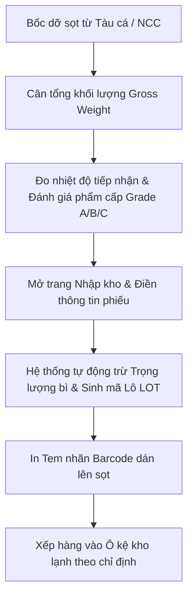
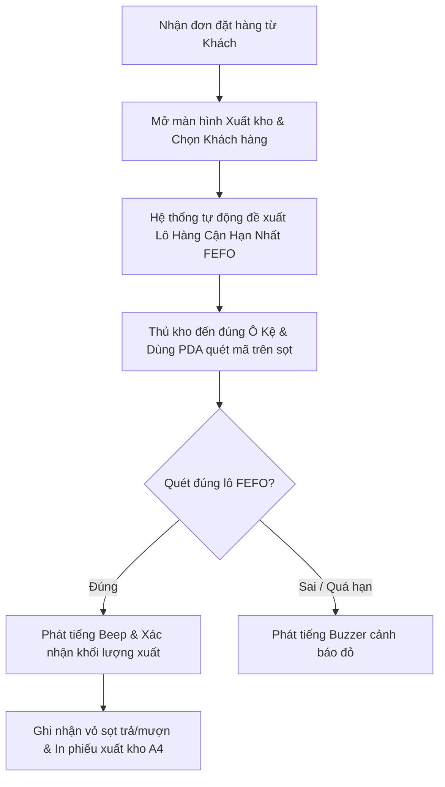

# TÀI LIỆU HƯỚNG DẪN SỬ DỤNG HỆ THỐNG
## HỆ THỐNG QUẢN LÝ KHO THỦY HẢI SẢN (SEAFOOD WAREHOUSE MANAGEMENT SYSTEM - WMS)

---

**Dành cho**: Thủ kho, Nhân viên Kiểm hàng (QC), Quản lý Kho, Kế toán Kho  
**Phiên bản ứng dụng**: 2.0 (Giao diện React / Ant Design)  
**Ngày phát hành**: 23/08/2026  

---

## MỤC LỤC
1. [HƯỚNG DẪN ĐĂNG NHẬP & TỔNG QUAN GIAO DIỆN](#1-hướng-dẫn-đăng-nhập--tổng-quan-giao-diện)
   - 1.1. [Đăng nhập & Đổi mật khẩu cá nhân](#11-đăng-nhập--đổi-mật-khẩu-cá-nhân)
   - 1.2. [Bố cục màn hình & Chuyển đổi Giao diện (Sáng / Tối)](#12-bố-cục-màn-hình--chuyển-đổi-giao-diện-sáng--tối)
   - 1.3. [Xem & Khai thác Bảng Điều Khiển Tổng Quan (Dashboard)](#13-xem--khai-thác-bảng-điều-khiển-tổng-quan-dashboard)
2. [QUY TRÌNH VẬN HÀNH NGHIỆP VỤ (STEP-BY-STEP)](#2-quy-trình-vận-hành-nghiệp-vụ-step-by-step)
   - 2.1. [Quy trình 1: Khai báo Danh mục Hải sản, Vỏ sọt Bao bì & Vị trí Kho Lạnh](#21-quy-trình-1-khai-báo-danh-mục-hải-sản-vỏ-sọt-bao-bì--vị-trí-kho-lạnh)
   - 2.2. [Quy trình 2: Tiếp nhận & Tạo Phiếu Nhập Kho Hải sản (Inbound)](#22-quy-trình-2-tiếp-nhận--tạo-phiếu-nhập-kho-hải-sản-inbound)
   - 2.3. [Quy trình 3: Tạo & Xử lý Phiếu Xuất Kho theo Chiến lược FEFO (Outbound)](#23-quy-trình-3-tạo--xử-lý-phiếu-xuất-kho-theo-chiến-lược-fefo-outbound)
   - 2.4. [Quy trình 4: Quản lý Sơ đồ Kho 2D, Kiểm kê & Xử lý Hao hụt Khối lượng](#24-quy-trình-4-quản-lý-sơ-đồ-kho-2d-kiểm-kê--xử-lý-hao-hụt-khối-lượng)
3. [HƯỚNG DẪN SỬ DỤNG CHẾ ĐỘ MÁY QUÉT CẦM TAY (PDA SCANNER MODE)](#3-hướng-dẫn-sử-dụng-chế-độ-máy-quét-cầm-tay-pda-scanner-mode)
4. [XỬ LÝ SỰ CỐ & CÁC LỖI THƯỜNG GẶP (TROUBLESHOOTING & FAQS)](#4-xử-lý-sự-cố--các-lỗi-thường-gặp-troubleshooting--faqs)

---

## 1. HƯỚNG DẪN ĐĂNG NHẬP & TỔNG QUAN GIAO DIỆN

### 1.1. Đăng nhập & Đổi mật khẩu cá nhân
1. Mở trình duyệt web (Google Chrome, Edge) và truy cập vào địa chỉ hệ thống kho.
2. Tại màn hình Đăng nhập:
   - Nhập **Tên đăng nhập / Email** (Ví dụ: `thukho1@seafood.vn` hoặc `admin`).
   - Nhập **Mật khẩu**.
   - Bấm nút **"Đăng nhập"** (màu xanh dương).
3. **Đổi mật khẩu cá nhân**:
   - Nhấp chuột vào **Avatar (Hình đại diện)** ở góc trên bên phải màn hình $\rightarrow$ Chọn **"Đổi mật khẩu"**.
   - Nhập Mật khẩu hiện tại $\rightarrow$ Nhập Mật khẩu mới $\rightarrow$ Xác nhận mật khẩu mới $\rightarrow$ Bấm **"Cập nhật"**.

### 1.2. Bố cục màn hình & Chuyển đổi Giao diện (Sáng / Tối)
- **Thanh Menu bên trái (Sidebar)**: Chứa toàn bộ các phân hệ nghiệp vụ:
  - 📊 **Bảng điều khiển**: Xem tổng quan chỉ số, cảnh báo, biểu đồ luồng hàng.
  - 🗄️ **Quản lý kho**: Tồn kho hiện tại, 🗺️ Sơ đồ kho 2D, Nhập kho, Xuất kho, Lịch sử giao dịch, Hao hụt & Phân loại, Thu hồi vỏ sọt.
  - 📁 **Dữ liệu nền**: Nhóm danh mục, Hải sản, Kho bãi, Bao bì, Đối tác tàu cá & Khách hàng.
  - 📈 **Báo cáo & Phân tích**: Thống kê tổng hợp, Cảnh báo kho lạnh.
- **Thanh Header trên cùng**:
  - Nút **`📱 Quét PDA`** (Màu xanh): Mở ngay màn hình máy quét mã vạch chuyên dụng.
  - Nút **Mặt trời / Mặt trăng**: Chuyển đổi chế độ **Giao diện Tối (Dark Mode)** giúp chống chói mắt khi làm việc ban đêm trong kho lạnh.
  - Nút **Chuông thông báo**: Hiển thị các cảnh báo nhiệt độ kho hoặc lô hàng cận hạn.

### 1.3. Xem & Khai thác Bảng Điều Khiển Tổng Quan (Dashboard)
Ngay khi đăng nhập, màn hình Dashboard cung cấp 4 khối thông tin quan trọng:
1. **Khối Cảnh báo Khẩn (Băng đỏ trên cùng)**:
   - Thông báo ngay số lượng *Lô hàng sắp hết hạn*, *Tủ đông lệch nhiệt độ*, *Mặt hàng sắp cạn kho*.
   - Nhấp trực tiếp vào thẻ để xem chi tiết danh sách cảnh báo.
2. **Khối 4 Thẻ Chỉ Số Phát Sáng (KPI Cards)**:
   - **Tổng Tồn Kho Hiện Tại**: Tổng khối lượng (Kg) và Ước tính tổng giá trị hàng tồn (VNĐ).
   - **Nhập Kho Hôm Nay**: Số Kg nhập và tổng số phiếu nhập trong ngày.
   - **Xuất Kho Hôm Nay**: Số Kg xuất và tổng số giao dịch xuất cho khách.
   - **Tỷ Lệ Hao Hụt Tháng**: Tỷ lệ % hao hụt so với định mức cho phép (<= 2.0%).
3. **Biểu đồ Sản lượng Nhập - Xuất 7 ngày & Cơ cấu Tồn kho**:
   - Cột xanh dương (Nhập), Cột xanh lá (Xuất).
   - Biểu đồ tròn thể hiện tỷ trọng giữa các nhóm (Cá đông lạnh, Tôm, Cua ghẹ, Thân mềm).
4. **Thao Tác Nhanh**: Các nút bấm lớn dẫn thẳng đến *Sơ đồ kho 2D*, *Nhập kho*, *Xuất kho*, *Báo hao hụt*.

---

## 2. QUY TRÌNH VẬN HÀNH NGHIỆP VỤ (STEP-BY-STEP)

### 2.1. Quy trình 1: Khai báo Danh mục Hải sản, Vỏ sọt Bao bì & Vị trí Kho Lạnh

#### Bước 1: Khai báo Sản phẩm Hải sản
1. Vào menu **Dữ liệu nền** $\rightarrow$ Chọn **"Danh mục hải sản"**.
2. Nhấn nút **"+ Thêm mới sản phẩm"** (góc phải trên).
3. Điền các trường thông tin trong Modal:
   - **Mã sản phẩm**: Nhập mã duy nhất (Ví dụ: `CA-HOI-01`, `TOM-SU-20`).
   - **Tên hải sản**: Nhập tên thương phẩm (Ví dụ: *Cá Hồi Na Uy Phi Lê*).
   - **Nhóm danh mục**: Chọn từ danh sách (*Cá tươi, Cá đông lạnh, Tôm/Cua...*).
   - **Loại bảo quản**: Chọn `Cấp đông sâu (-25°C)`, `Kho mát`, hoặc `Bể oxy`.
   - **Hạn bảo quản tối đa (Ngày)**: Ví dụ `180` ngày đối với hàng đông lạnh hoặc `3` ngày đối với hàng sống.
   - **Ngưỡng tồn tối thiểu (Kg)**: Nhập mức cảnh báo cạn hàng (Ví dụ: `500` kg).
4. Bấm **"Lưu thông tin"** $\rightarrow$ Hệ thống hiển thị thông báo xanh: *"Thêm sản phẩm thành công"*.

#### Bước 2: Khai báo Vỏ sọt / Bao bì Luân chuyển
1. Vào menu **Dữ liệu nền** $\rightarrow$ Chọn **"Danh mục bao bì"**.
2. Bấm **"+ Thêm loại bao bì"**:
   - **Mã bao bì**: Ví dụ `SOT-VANG-20KG`, `KHAY-CAPDONG`.
   - **Tên quy cách**: *Sọt nhựa vàng tiêu chuẩn 20kg*.
   - **Trọng lượng bì (Tare weight - Kg)**: Ví dụ `1.8` kg (Trọng lượng này sẽ tự động trừ đi khi cân cả sọt hàng).
   - **Giá trị cọc (VNĐ)**: Ví dụ `50.000` VNĐ/vỏ sọt.
3. Bấm **"Xác nhận"**.

---

### 2.2. Quy trình 2: Tiếp nhận & Tạo Phiếu Nhập Kho Hải sản (Inbound)

#### Chi tiết các bước thực hiện trên phần mềm:
1. Vào menu **Quản lý kho** $\rightarrow$ Chọn **"Nhập kho hải sản"** (hoặc bấm phím tắt trên Dashboard).
2. **Phần Thông Tin Chung**:
   - **Chọn Tàu cá / Nhà cung cấp**: Chọn tên đối tác (Ví dụ: *Tàu cá Kiên Giang KG-94567-TS*).
   - **Chọn Kho tiếp nhận**: Chọn kho (Ví dụ: *Tổng Kho Lạnh A*).
   - **Ngày nhập**: Mặc định ngày giờ hiện tại.
3. **Phần Chi Tiết Lô Hàng**:
   - **Sản phẩm**: Chọn hải sản cần nhập.
   - **Khối lượng tổng cân được (Gross)**: Nhập số cân đo được.
   - **Loại sọt & Số lượng sọt**: Chọn loại sọt (Hệ thống sẽ lấy *Số sọt x Trọng lượng bì* để tự động tính ra **Khối lượng tịnh thực tế Net Weight**).
   - **Đơn giá thu mua**: Nhập giá/kg.
   - **Ngày đánh bắt / Cấp đông**: Chọn ngày.
   - **Hạn sử dụng**: Chọn hạn dùng (Hệ thống tự gợi ý theo số ngày bảo quản của sản phẩm).
   - **Nhiệt độ lúc nhập (°C)**: Nhập số đo nhiệt kế (Ví dụ: `-21.0`).
   - **Phẩm cấp**: Chọn `Grade A` (Loại 1 tươi ngon), `Grade B` (Loại 2), hoặc `Grade C`.
   - **Vị trí xếp kho**: Chọn Ô kệ đích (Ví dụ: Ô `A1-01`).
4. **Lưu & In Mã Tem Nhãn**:
   - Nhấn nút **"Lưu & In Mã Tem"** (Màu xanh lá).
   - Hệ thống phát âm thanh **Beep** thành công, cấp mã lô định dạng `LOT-YYYYMMDD-XXXX` và mở cửa sổ in tem mã vạch QR.
   - Dán tem in lên thân sọt hàng và tiến hành xếp sọt vào đúng vị trí ô kệ đã đăng ký.

---

### 2.3. Quy trình 3: Tạo & Xử lý Phiếu Xuất Kho theo Chiến lược FEFO (Outbound)

> **LƯU Ý CỐT LÕI (FEFO)**: Hệ thống luôn ưu tiên bắt buộc xuất các lô hàng có **Hạn sử dụng gần nhất** trước để đảm bảo hải sản không bị suy giảm chất lượng hoặc tồn kho quá lâu.

#### Chi tiết các bước thực hiện trên phần mềm:
1. Vào menu **Quản lý kho** $\rightarrow$ Chọn **"Xuất kho hải sản"**.
2. Chọn **Khách hàng / Đại lý thu mua** và **Kho xuất**.
3. Chọn mặt hàng cần xuất $\rightarrow$ Hệ thống tự động kích hoạt **Thuật toán Gợi ý FEFO**:
   - Bảng danh sách hiển thị các lô hàng khả dụng, **lô có hạn dùng ngắn nhất được xếp lên vị trí số 1** kèm biểu tượng ngôi sao ưu tiên và vị trí ô kệ (Ví dụ: *Lô LOT-20260810-001 tại Kệ A1-02 còn hạn 14 ngày*).
4. **Xác thực quét mã bằng Máy quét / Camera PDA**:
   - Bấm nút **"Quét mã xác thực"** trên dòng lô hàng.
   - Đưa máy quét vào mã QR trên sọt:
     - Nếu quét đúng: Hệ thống phát tiếng **Beep**, hiển thị dấu tick xanh và tự động điền mã lô.
     - Nếu quét sai lô: Hệ thống phát tiếng **Buzzer** cảnh báo và hiển thị hộp thoại: *"Cảnh báo: Lô này không phải lô ưu tiên xuất trước theo nguyên tắc FEFO"*.
5. Nhập **Khối lượng xuất thực tế (Kg)** và **Đơn giá bán**.
6. **Giao mượn / Thu hồi vỏ sọt**:
   - Nhập số lượng sọt khách trả lại tại chỗ.
   - Nhập số lượng sọt cho khách mượn chở hàng về (Công nợ sọt sẽ tự động ghi vào hồ sơ khách hàng).
7. Bấm **"Hoàn tất Phiếu Xuất"** $\rightarrow$ In phiếu xuất kho 2 liên (1 liên lưu kho, 1 liên giao tài xế/khách).

---

### 2.4. Quy trình 4: Quản lý Sơ đồ Kho 2D, Kiểm kê & Xử lý Hao hụt Khối lượng

#### 1. Sử dụng Sơ đồ Kho Lạnh 2D (Visual Map)
1. Vào menu **Quản lý kho** $\rightarrow$ Chọn **"🗺️ Sơ đồ kho 2D"** (đường dẫn `/inventory/map`).
2. Quan sát trực quan các phân khu:
   - **Zone A**: Cấp đông sâu (-25°C ~ -18°C).
   - **Zone B**: Kho mát (-18°C ~ -10°C).
   - **Zone C**: Bể sống oxy (15°C ~ 18°C).
3. Nhìn màu sắc của các ô:
   - 🟢 **Xanh lá**: Ô trống hoặc còn nhiều chỗ (< 50%).
   - 🟡 **Vàng**: Ô đã chứa 50% - 85%.
   - 🔴 **Đỏ**: Ô đầy tải (> 85%).
   - 🟣 **Tím nhấp nháy**: Trong ô có lô hàng **Cận Date** cần ưu tiên xuất gấp!
4. **Xem chi tiết & Thao tác nhanh**: Nhấp chuột vào bất kỳ ô nào $\rightarrow$ Cửa sổ bên phải hiển thị danh sách toàn bộ các lô đang lưu $\rightarrow$ Bấm nút **"Xuất nhanh lô này"** để tạo phiếu xuất tức thì.

#### 2. Xử lý Hao hụt Khối lượng & Hạ phẩm cấp (Wastage)
Khi kiểm tra phát hiện hải sản bị hao hụt trọng lượng do thoát hơi nước trữ đông hoặc hư hỏng:
1. Vào menu **Quản lý kho** $\rightarrow$ Chọn **"Hao hụt & Phân loại"**.
2. Bấm **"+ Tạo biên bản hao hụt"**:
   - Chọn **Lô hàng** phát sinh sự cố.
   - Chọn **Lý do**: *Mất nước tự nhiên (Shrinkage), Hư hỏng rã đông, Chết trong bể oxy, hoặc Hạ phẩm cấp (Grade A -> Grade B)*.
   - Nhập **Khối lượng hao hụt (Kg)**.
   - Chọn **Biện pháp xử lý**: *Hủy bỏ tiêu hủy, Bán thanh lý giảm giá, hoặc Tái chế làm thức ăn gia súc*.
3. Bấm **"Gửi phê duyệt"**:
   - Phiếu dưới 5 triệu VNĐ: Thủ kho tự duyệt và hệ thống trừ tồn kho ngay.
   - Phiếu trên 5 triệu VNĐ: Chuyển trạng thái *"Chờ Quản lý duyệt"* trước khi trừ tồn kho.

---

## 3. HƯỚNG DẪN SỬ DỤNG CHẾ ĐỘ MÁY QUÉT CẦM TAY (PDA SCANNER MODE)

Chế độ **Quét PDA** được thiết kế đặc biệt cho công nhân mang găng tay bảo hộ dày, thao tác bằng một tay trong kho lạnh.

1. Bấm nút **`📱 Quét PDA`** trên thanh Header (hoặc phím tắt nhanh).
2. Màn hình quét toàn diện hiện ra:
   - **Khung Camera Viewfinder**: Có đường tia laser xanh quét lên xuống.
   - **Công tắc "Âm báo"**: Bật/Tắt âm thanh phản hồi (Mặc định: BẬT).
   - **Công tắc "Quét liên tục"**: Khi BẬT, máy sẽ quét liên tiếp nhiều sọt mà không bị đóng màn hình.
3. Hướng đầu đọc hoặc camera vào mã QR trên sọt hải sản:
   - Ngay khi quét được, hệ thống phát tiếng **Beep** và hiển thị ngay: *Tên hải sản, Mã lô, Vị trí ô kệ, Số kg tồn và Hạn dùng*.
   - Phía dưới có sẵn nút bấm to: **"Tạo Phiếu Xuất Kho Với Mã Này"** hoặc **"Tạo Phiếu Nhập Kho"**.

---

## 4. XỬ LÝ SỰ CỐ & CÁC LỖI THƯỜNG GẶP (TROUBLESHOOTING & FAQS)

### 4.1. Bảng Tra Cứu Thông Báo Lỗi & Cách Khắc Phục

| Mã / Hiện tượng lỗi | Nguyên nhân | Hướng dẫn xử lý |
| :--- | :--- | :--- |
| ⚠️ **"Cảnh báo: Lô hàng không theo nguyên tắc FEFO"** | Bạn đang chọn hoặc quét một lô có hạn sử dụng dài hơn trong khi kho vẫn còn lô cận hạn hơn. | **Khắc phục**: Kiểm tra lại gợi ý FEFO màu xanh trên đầu danh sách và lấy đúng lô cận hạn xuất trước. Nếu khách yêu cầu đích danh lô mới, cần nhập lý do giải trình. |
| ❌ **"Lô hàng đã quá hạn sử dụng (Expired)"** | Hạn sử dụng của lô nhỏ hơn ngày hiện tại. | **Khắc phục**: Hệ thống tự động khóa không cho xuất bán thương phẩm. Vui lòng chuyển sang phân hệ *Hao hụt & Phân loại* để lập biên bản xử lý hủy hoặc bán thanh lý bột cá. |
| 📷 **"Không nhận được hình ảnh Camera"** | Trình duyệt chưa được cấp quyền truy cập Camera hoặc Camera đang bị ứng dụng khác chiếm giữ. | **Khắc phục**: 1. Bấm nút **"Thử kết nối lại"**; 2. Kiểm tra biểu tượng ổ khóa cạnh thanh địa chỉ web để "Cho phép (Allow) Camera"; 3. Chọn lại Camera sau trong danh sách dropdown. |
| ⚠️ **"Mã quét hợp lệ nhưng chưa gắn với lô hàng tồn"** | Mã QR/Barcode vừa quét là mã mới in chưa nhập kho hoặc đã xuất hết sạch tồn (Qty = 0). | **Khắc phục**: Kiểm tra lại xem phiếu Nhập kho của lô này đã được bấm lưu thành công chưa tại trang *Lịch sử giao dịch*. |
| 🚫 **"Số lượng xuất vượt quá tồn kho thực tế"** | Nhập số Kg xuất lớn hơn số Kg còn lại trong lô. | **Khắc phục**: Kiểm tra lại số cân tồn hiển thị trên màn hình. Nếu thực tế trong kho còn nhiều hơn do cân sai lúc nhập, cần báo Quản lý làm phiếu điều chỉnh tồn. |

### 4.2. Các Câu Hỏi Thường Gặp (FAQs)
- **Q: Tại sao khi cân một sọt cá 21.8 kg hệ thống chỉ ghi nhận 20.0 kg?**  
  *A: Vì hệ thống đã tự động trừ đi 1.8 kg Trọng lượng bì (Tare weight) của vỏ sọt nhựa vàng mà bạn đã chọn.*
- **Q: Làm thế nào khi mất mạng Internet trong lúc đang quét hàng trong kho lạnh?**  
  *A: Hệ thống có bộ đệm lưu trữ tạm thời. Sau khi thiết bị bắt lại sóng Wi-Fi kho, hãy bấm nút "Làm mới" (Reload) để dữ liệu đồng bộ hoàn toàn lên máy chủ.*

---
*Tài liệu này được lưu hành nội bộ phục vụ đào tạo nhân sự vận hành hệ thống Seafood Warehouse Management System.*
